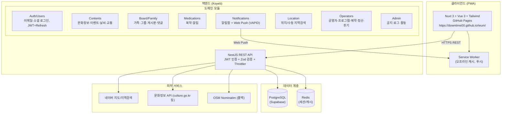
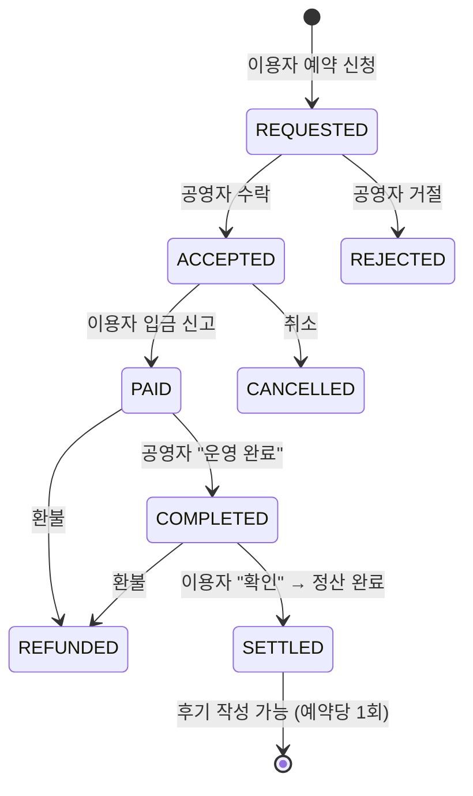
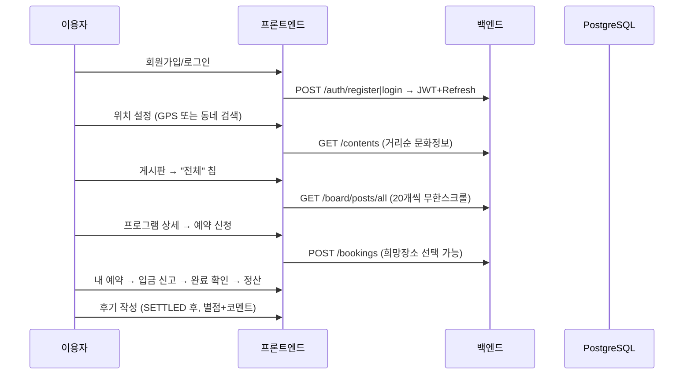
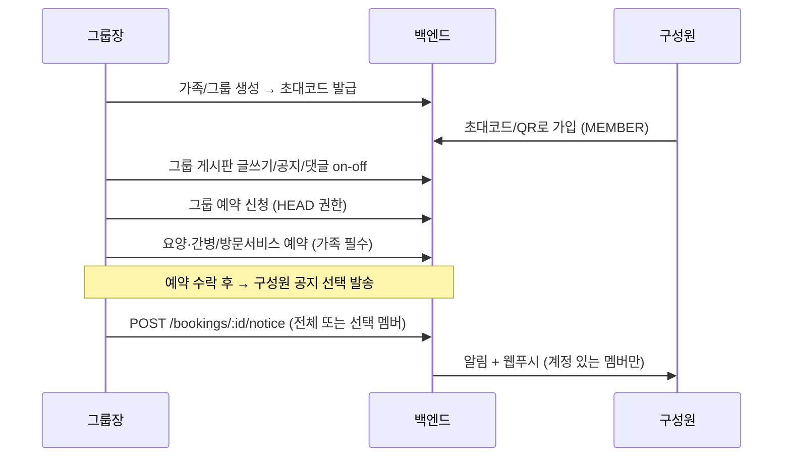
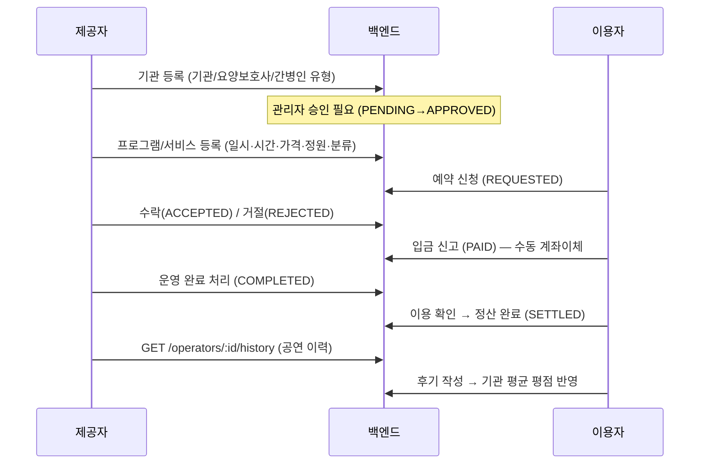

# IEUM 시스템 다이어그램 및 사용자 시나리오 검토

> 최종 갱신: B2B2C 예약 플랫폼 + 게시판 전체 보기 + 무한스크롤 반영 기준

## 1. 전체 시스템 구성

## 2. 도메인 모듈 맵

| 영역 | 모듈 | 주요 테이블 |
|---|---|---|
| 인증/사용자 | auth, users | users, user_profiles, refresh_tokens |
| 생활정보 | contents, events, location, data-collector | contents, events, event_participations |
| 가족/그룹 | family, board | families, family_members, family_invite_codes, family_posts, family_post_comments |
| 복지 알림 | medications, notifications | medications, notifications, push_subscriptions |
| **B2B2C 마켓** | **operators** | operators, operator_programs, program_bookings, operator_reviews |
| 운영 | admin, logs | notices, admin_activities, logs |

## 3. B2B2C 예약·정산 상태머신

금액 계산 (예약 시점 스냅샷): `platformFee = total × feeRate(기본 10%)`, `settlement = total − fee`

예약 분기 규칙:
- 개인 예약(공연·강의·체험): 누구나
- 그룹 예약(`familyId` 지정): **HEAD(그룹장)만**
- 요양·간병/방문서비스: **가족 지정 필수 + HEAD만** + 희망 장소(주소/좌표) 필수

## 4. 액터별 시나리오

### 4.1 일반 사용자 (어르신/이용자)

**주요 기능**: 문화정보/이벤트 탐색, 복약·메모 알림, 날씨/대중교통, 가족·그룹 게시판(전체 보기), 프로그램 예약·입금·확인·후기, 공지 수신.

### 4.2 그룹장 (가족/그룹 관리자)

### 4.3 공영자 / 요양보호사 / 간병인 (서비스 제공자)

## 5. 시나리오 검토 — 갭 및 리스크

### 정상 동작 확인됨 (로컬 E2E)
- 기관 등록→승인→프로그램 등록→예약→수락→입금→완료→확인→정산→후기→평점 집계
- 그룹 권한(HEAD 전용), 요양 예약 필수조건, 구성원 공지, 전체 보기 페이징

### ⚠️ 발견된 갭 (우선순위 순)

| # | 항목 | 현황 | 권장 조치 |
|---|---|---|---|
| 1 | **인증 부재 엔드포인트** | ✅ operators 모듈은 `UserAuthGuard`(Bearer JWT + userId 일치 검증) 적용 완료. 프론트는 fetch 래퍼로 헤더 자동 첨부. **board/기타 모듈은 여전히 `?userId=` 신뢰** | board·medications·notifications 등 나머지 모듈에도 동일 가드 단계적 적용 |
| 2 | **실결제 미구현** | 수동 입금 신고만. 플랫폼 수수료는 상태값일 뿐 실제 에스크로 아님 | PG 연동(토스페이먼츠 등) + 정산 자동화 |
| 3 | **정원 초과 가능** | ✅ REQUESTED/ACCEPTED/PAID 인원을 좌석 홀드로 계산, 신청·수락 시 정원 검증 추가 | 프로그램 잔여석 표시도 홀드 반영 검토 |
| 4 | **기관 승인 무방어** | ✅ `AdminAuthGuard` — ADMIN/SUPER_ADMIN role만 승인/반려 가능 | 관리자 승인 UI 추가 |
| 5 | **프로덕션 마이그레이션** | ✅ `src/migrations/create-operators-tables.ts` 작성 (operators/operator_programs/program_bookings/operator_reviews) | typeorm CLI 연결 또는 SQL 수동 실행 필요 |
| 6 | **웹푸시 키 미설정** | Koyeb에 `VAPID_PUBLIC_KEY/PRIVATE_KEY` 없으면 푸시 발송 불가 | env 등록 필요 |
| 7 | **미등록 모듈** | ✅ AudioStreamModule 등록 + `AudioPlayerService` InjectRepository 누락 수정. ⚠️ RecommendationModule은 `Content` 엔티티가 contents/users 두 군데 중복 정의라 보류 (프론트 미사용) | 레거시 엔티티 통합 후 재등록 |
| 8 | **앱 미사용 멤버** | `userId=null` 구성원은 알림/푸시 수신 불가 (의도된 동작) | 대체 채널(문자/전화) 검토 |
| 9 | **전체 보기 상한** | posts/all은 최대 1000건 스캔 후 20개씩 페이징 | 데이터 증가 시 커서 기반 페이지네이션 권장 |
| 10 | **i18n 미적용 페이지** | operators/bookings 등 신규 B2B 화면은 한국어 하드코딩 | 다국어 확장 시 점진적 적용 |

## 6. 배포 구성

| 구성요소 | 위치 | 비고 |
|---|---|---|
| 프론트엔드 | GitHub Pages (`frontend` 브랜치) | baseURL `/ieum/`, PWA |
| 백엔드 | Koyeb (`main` 브랜치) | env: DATABASE_URL, JWT_SECRET, ALLOWED_ORIGINS, VAPID_* |
| DB/캐시 | Supabase PostgreSQL + Redis | ssl 연결 |
