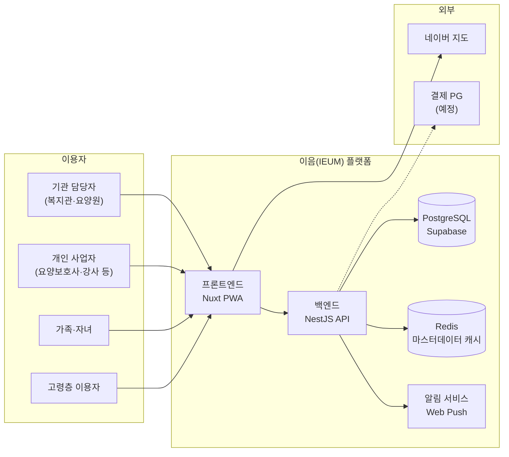
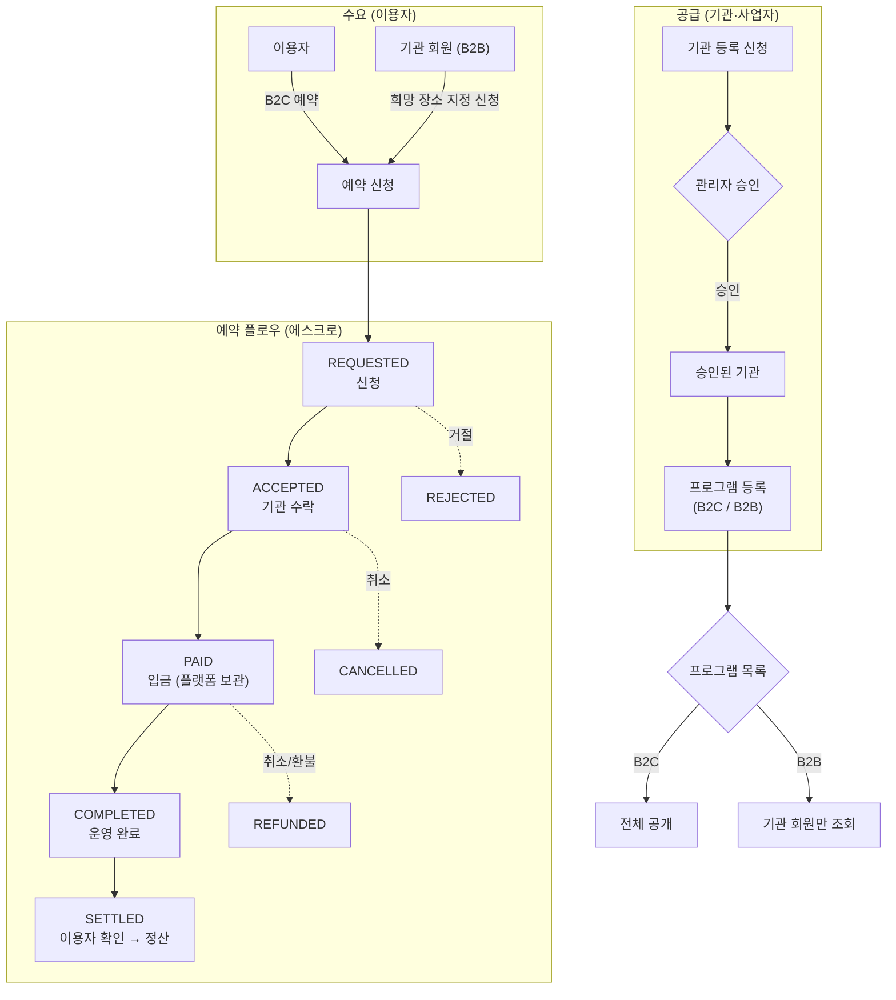
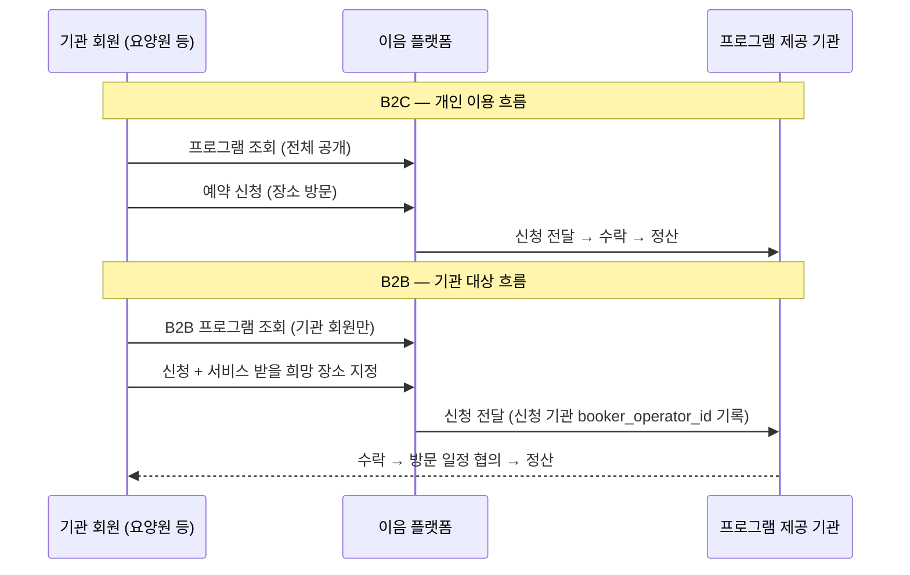

# 이음(IEUM) 서비스 기획서

> 지역 생활정보 플랫폼 — 어르신과 가족을 위한 지역 맞춤 정보·돌봄·여가 연결 서비스

---

## 1. 서비스 개요

**이음(IEUM)**은 지역 주민, 특히 고령층이 거주 지역의 복지·문화·돌봄 정보를 한곳에서 얻고, 예약·신청·소통까지 할 수 있는 모바일 우선 웹 플랫폼(PWA)입니다.

- **슬로건 방향**: "우리 동네의 모든 것을, 이음처럼 이어드립니다"
- **핵심 차별점**: 단순 정보 나열이 아니라 **지역 기반 + 가족 단위 + 예약/정산까지 연결**되는 올인원 구조

### 서비스 전체 구조

---

## 2. 배경 및 문제 의식

| 문제 | 현재 상황 | 이음의 해결 |
|---|---|---|
| 복지 정보 분산 | 복지관·노인회관·문화센터 공지가 기관별 홈페이지/게시판에 흩어짐 | 기관·사업자가 직접 등록 → 한 플랫폼에서 조회 |
| 디지털 소외 | 고령층은 앱 설치·복잡한 UI에 취약 | 큰 글씨 모드, 음성 입력, PWA(설치 불필요), 직관적 카드 UI |
| 가족 소통 단절 | 부모님 근황·일정을 가족이 따로 챙겨야 함 | 가족/그룹 게시판, 그룹 예약, 알림 공지 |
| 돌봄 서비스 접근성 | 요양·간병·방문서비스 예약이 전화/방문 위주 | 온라인 신청 → 기관 수락 → 입금 → 정산까지 온라인 |
| 기관-이용자 괴리 | 복지관 프로그램 정원·신청 현황 파악 어려움 | 실시간 잔여석, 예약 관리, 후기·평점 |

---

## 3. 타겟 사용자

### 3-1. Primary (핵심)
- **65세 이상 고령층** — 복지·문화·돌봄 정보 소비자
- **고령층 자녀·가족** — 부모님 일정 관리, 그룹 예약 대행

### 3-2. Secondary
- **복지관·노인회관·복지센터 등 기관** — 프로그램 홍보·회원 모집 채널
- **요양보호사·간병인·강사 등 개인 사업자** — 서비스 제공자
- **요양원·주간보호센터 등 B2B 기관** — 기관 단위 프로그램 수급

---

## 4. 핵심 기능 구성

### 4-1. 지역 정보 허브
- **대시보드**: 날씨, 공지사항, 알림, 빠른 메뉴
- **문화 정보**: 공연·전시·강좌 목록 + **네이버 지도 기반 지도 뷰** (내 위치/지역 검색, 5km 반경 필터)
- **약·병원**: 복용 알림(복약 스케줄), 병원 정보
- **로컬 알림**: Web Push(VAPID) 기반 지역·일정 알림

### 4-2. 가족·그룹 게시판
- 가족/이웃 그룹 생성·가입 (초대코드/QR, 공개 그룹 검색)
- 그룹 게시글·댓글, 공지글, 새 글 뱃지
- 권한 체계: 그룹장(HEAD) 관리·삭제 권한, 구성원 읽기/쓰기, 게스트 열람 전용

### 4-3. 기관·사업자 생태계 (B2B2C)

- **기관 등록 → 관리자 승인 → 운영** 구조 (승인제)
- 기관 유형 마스터 관리 (행복복지센터, 실버타운, 요양보호사, 간병인, 강사 등 — DB+Redis 관리)
- 프로그램 등록: 분류·일정·정원·가격·장소·썸네일
- **예약 플로우**: 신청(REQUESTED) → 기관 수락(ACCEPTED) → 입금 신고(PAID, 에스크로) → 운영 완료(COMPLETED) → 이용자 확인(SETTLED) → **정산**
- 후기·평점, 예약 공지(가족 알림), 이력 관리

### 4-4. B2B / B2C 구분 (신규)

| 구분 | 대상 | 흐름 |
|---|---|---|
| **B2C** | 개인 이용자 | 기관 장소로 방문 — 일반 예약 |
| **B2B** | 기관·요양원 | 승인된 기관 회원만 열람·신청, **서비스 받을 희망 장소 지정** — 기관 단위 수급 |

- B2B 프로그램은 일반 사용자 목록에 비노출, 기관 회원 전용 조회 API 분리
- B2B 신청 시 신청 기관(`booker_operator_id`) 추적 → 기관 간 거래 관리 기반

### 4-5. 접근성·시니어 모드
- 큰 글씨 모드, 음성 받아쓰기(게시판), 진동 설정
- PWA: 앱 설치 없이 홈 화면 추가, 오프라인 캐시
- 읽기/쓰기 최소화한 직관적 플로우

---

## 5. 수익 모델

| 모델 | 내용 | 상태 |
|---|---|---|
| **플랫폼 수수료** | 예약 금액의 일정 %(기본 10%, 기관별 조정 가능 `feeRate`) | 구현됨 — 에스크로 후 정산 |
| **B2B 기관 계약** | 요양원·복지관 단위 프로그램 패키지/정액 계약 | 기획 — B2B 플로우 기반 |
| **B2B2C 제휴** | 지자체 복지관·공공기관 협업 시 수수료 면제/별도 계약 | 검토 |
| **광고/노출** | 지역 업체 배너·추천 슬롯 | 미구현 — 트래픽 확보 후 |

---

## 6. 기술 스택

| 영역 | 기술 |
|---|---|
| 프론트엔드 | Nuxt 4 (Vue 3) + Tailwind CSS + Pinia, PWA(@vite-pwa) |
| 백엔드 | NestJS + TypeORM + PostgreSQL (Supabase) |
| 캐시 | Redis (마스터 데이터·세션성 캐시) |
| 인증 | JWT Access/Refresh + 소셜 로그인(카카오·네이버·구글) |
| 지도 | 네이버 지도 JS API |
| 배포 | GitHub Pages(프론트) / 컨테이너 런타임(백엔드) |

### 설계 원칙
- **마스터 데이터는 DB+Redis**: 기관 유형·프로그램 분류 등 사용자 선택 목록은 하드코딩 대신 DB 관리 + Redis 캐시(1h) + HTTP 캐시 + localStorage 2단 캐시
- **권한은 서버 강제**: 프론트 버튼 숨김과 별개로 백엔드에서 매 요청 검증
- **승인제 운영**: 기관·공지·유형 변경은 관리자 승인/관리 하에 노출

---

## 7. 로드맵

### Phase 1 — 기반 (완료)
- [x] 인증/소셜 로그인, 대시보드, 문화정보(목록+지도), 날씨
- [x] 가족·그룹 게시판, 알림(푸시), 복약 알림
- [x] 시니어 모드·음성 입력·PWA

### Phase 2 — 거래 플랫폼 (진행 중)
- [x] 기관 등록·승인제, 프로그램 등록/관리
- [x] 예약·입금·정산 플로우, 후기·평점
- [x] B2B/B2C 구분, 기관 대상 프로그램
- [ ] **실제 결제 PG 연동** (현재 수동 입금 확인 방식)
- [ ] 정산 자동화·정산 주기·세금계산서 대응
- [ ] 기관 전용 대시보드 (B2B 수급 현황, 이용자 관리)

### Phase 3 — 성장
- [ ] 지자체·공공 복지관 데이터 연동 (공공 API)
- [ ] B2B 패키지 상품(기관 정기 프로그램)
- [ ] 카카오톡 알림 채널 연동
- [ ] 다국어 완성도 확대 (현재 ko/en 기본)

### Phase 4 — 확장
- [ ] 주변 병원·약국 실시간 정보
- [ ] AI 추천 (복용 주의, 프로그램 추천)
- [ ] 오프라인 모임/자원봉사 매칭

---

## 8. 주요 리스크 및 대응

| 리스크 | 대응 |
|---|---|
| 고령층 디지털 사용성 | 시니어 모드·음성·큰 터치 영역, 실사용자 테스트 반복 |
| 기관 공급 부족 (콜드스타트) | 지자체 협업, 초기 기관 수수료 면제, 공공 데이터 시딩 |
| 결제 분쟁 | 에스크로 구조, 단계별 상태 관리, 환불 정책 명시 |
| B2B 수요 불확실 | 소수 기관 파일럿 → 수요 검증 후 확장 |
| 개인정보(건강·위치) | 최소 수집, 암호화, 이용 목적 고지, 접근 권한 분리 |

---

## 9. 성공 지표 (안)

- **활성 사용자**: MAU, 7일 재방문율
- **콘텐츠**: 등록 프로그램 수, 월 신규 프로그램
- **거래**: 월 예약 건수·GMV, 정산 완료율, 후기 작성률
- **기관**: 승인 기관 수, B2B 신청 전환율
- **시니어 경험**: 시니어 모드 사용률, 이탈률(연령대별)

---

## 10. 경쟁·대안 서비스와의 차이

| 서비스 | 차이점 |
|---|---|
| 네이버/카카오 지도·플레이스 | 정보 나열 중심, 예약·정산·가족 관리 없음 |
| 복지로/지자체 사이트 | 공공 중심, 개인화·소통·거래 약함 |
| 시니어 앱(케어닥 등) | 돌봄 특화, 문화·지역 커뮤니티 약함 |
| **이음** | 지역 정보 + 가족 그룹 + 예약·정산 + B2B 기관 채널 통합 |

---

*본 기획서는 현재 구현된 기능을 기준으로 작성되었으며, 검토 의견 반영 후 Phase 2 세부 계획을 확정합니다.*
